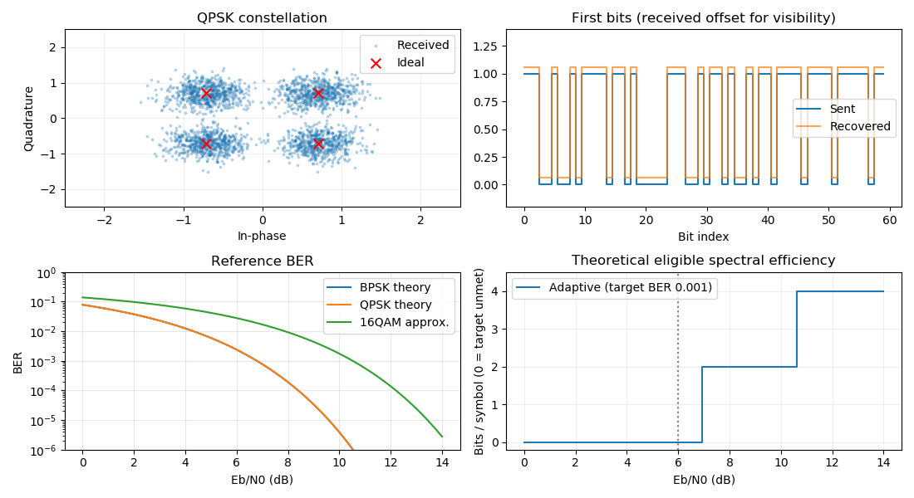
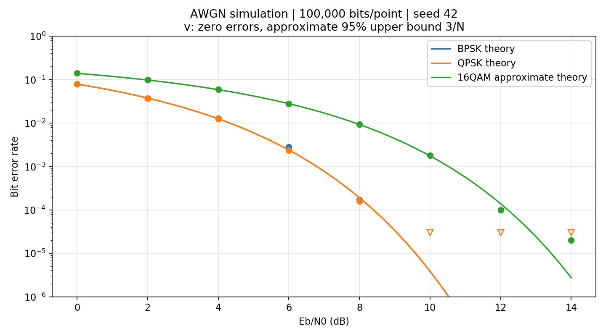

# 数字通信链路仿真与自适应调制演示系统

适合通信工程本科项目的 Python 基带仿真。发送 UTF-8 文字，经过调制、复高斯白噪声信道、最近邻判决后恢复文字；支持 BPSK、QPSK、Gray 16QAM、自适应调制和误码率实验。



## 功能

- UTF-8 文字发送与恢复、比特错误统计。
- BPSK、QPSK、Gray 16QAM 调制和最近邻解调。
- 可调 Eb/N0 的复基带 AWGN 信道。
- 星座图、比特对比、理论与仿真 BER 曲线。
- 基于理论 BER 门限的自适应调制教学策略。
- 固定随机种子的批量实验与 CSV、PNG 导出。

## 运行

Windows 双击 `start.bat`，或者在本目录执行：

```powershell
python main.py
```

先安装依赖，再启动界面：

```bash
python -m pip install -r requirements.txt
python main.py
```

依赖 NumPy、Matplotlib 和 Python 自带的 Tkinter。已在 Python 3.7.4、NumPy 1.16.5、Matplotlib 3.1.1 环境验证；其他版本组合尚未逐一验证，requirements.txt 中是最低版本要求。Tkinter 通常随 Windows 官方 Python 安装程序安装。Linux 环境可能需要通过系统包管理器另外安装 Tkinter；没有桌面显示环境时可运行下文的无界面实验。

如需隔离依赖，可先执行 `python -m venv .venv`，再激活虚拟环境后安装。Windows PowerShell 激活命令为 `.\.venv\Scripts\Activate.ps1`；macOS/Linux 为 `source .venv/bin/activate`。

## 操作

1. 输入文字、选择调制方式，设置 Eb/N0 和随机种子。
2. 点击“运行链路”，查看恢复文字、文字误码率、独立 40000 随机比特样本误码率、星座图和比特对比。
3. 选择 Adaptive 使用目标 BER=0.001 的理论门限策略。
4. 点击“运行误码率实验并导出”，对 0、2、…、14 dB 的三种调制各传输 100000 比特，导出 CSV 和界面图。

无界面实验：`python verify.py --export`，输出 `results/ber.csv` 和 `results/ber_curve.png`。
验证：`python verify.py`。

验证内容包括无噪声恢复与补零、平均星座能量归一化、UTF-8 往返、仿真 BER 与理论的一致性，以及自适应模式选择。



### 实验参数

| 参数 | 设置 |
|---|---|
| 信道 | 理想同步的复基带 AWGN |
| Eb/N0 | 0～14 dB，步长 2 dB |
| 每个模式每个实验点 | 100000 比特 |
| 批量实验随机种子 | 42 |
| 接收判决 | 最近邻判决 |
| 自适应目标 BER | 0.001 |

CSV 的列依次是 `ebn0_db`、`mode`、`errors`、`bits`、`ber`。`python verify.py --export` 可重新生成仓库中的基线结果；界面批量实验另外输出 `results/experiment.png`。

## 原理和范围

链路：文字 → UTF-8 → 比特 → 补零分组 → 星座映射 → AWGN → 最近邻解映射 → 去除补零 → UTF-8 解码。

星座平均符号能量 Es=1，每符号 k=log2(M) 比特。设 gamma_b=10^(Eb/N0_dB/10)，每个实部/虚部噪声的方差为 1/(2*k*gamma_b)。横轴统一为 Eb/N0。

BPSK/QPSK 理论 BER=Q(sqrt(2*gamma_b))；Gray 16QAM 采用高信噪比近似 3/4*Q(sqrt(0.8*gamma_b))，低信噪比时存在近似误差。

自适应模块假设接收端信道参数已知，以 0.05 dB 网格搜索理论 BER≤0.001 的门限，再选择满足条件且每符号比特数最多的模式。BPSK 与 QPSK 的 BER 理论曲线相同，因此当前理想模型下，有可用模式时通常直接选择 QPSK 或 16QAM；低于全部门限时回退 BPSK 并明确提示目标无法满足。这是教学策略，门限未经实测链路校准。效率图表示满足理论目标时的标称 bits/symbol，0 表示目标无法满足，不代表停止发送；不等于实测吞吐量。固定 Eb/N0 比较也意味着各模式每比特能量一致，不能直接视为固定符号能量下的工程调度策略。

模型假设理想同步、无编码、无多径、无载波频偏。文字很短时误码率波动大，性能评价应查看随机数据实验。中文字节损坏可能产生替换字符。零误码只表示有限样本未观测到错误，图中使用空心倒三角画出约 95% 误码率上界 3/N，CSV 保留实际零值。

## 文件结构

| 文件 | 职责 |
|---|---|
| core.py | 调制解调、信道、文字转换、理论公式、门限和批量实验 |
| main.py | Tkinter 界面和 Matplotlib 图表；后台线程执行批量实验 |
| verify.py | 无噪声恢复、能量归一化、UTF-8、理论 BER 一致性和策略验证；无界面导出 |
| results/ | 可复现实验数据和图表 |

## 答辩演示与学习路线

先在较高 Eb/N0 发送文字，再降低到 0 dB 观察错误和星座扩散；切换三种调制，对比星座密度；运行批量实验并解释仿真与理论关系；最后展示自适应模式与模型假设。

建议先阅读 core.py 的 constellation、modulate、demodulate 和 transmit，再运行 verify.py。可以逐步扩展信道编码、固定 Es/N0 下的自适应策略、衰落与均衡、信道估计；每次增加一个模块并重新验证理论基线。

## 开发说明

初始代码与文档由 AI 辅助生成，作为学习与实验起点。使用者应结合代码、验证脚本和实验结果理解实现，并如实描述个人完成的工作。

## 上传 GitHub

参见 [上传说明](docs/GITHUB_UPLOAD.md)。本项目使用 [MIT 许可证](LICENSE)。
